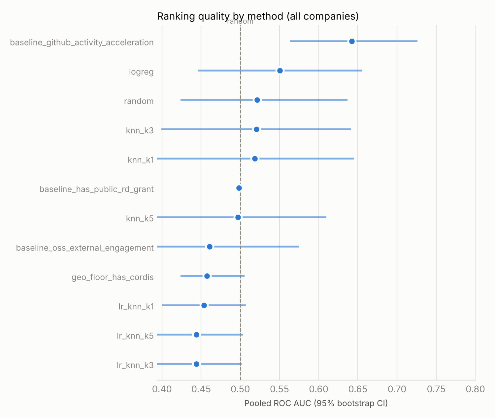

# Startup radar backtest — results (v1, selection years only)

> **EXPLORATORY RESULT** — only 27 funded companies are visible to the radar before their first round (target ≥ 100; below 30 the plan reports AUC as exploratory only). Treat every number below as indicative, with wide confidence intervals.

**Headline:** we flagged **4 of 27** funded startups in our candidate set a median of **3 months** before their first round (in the top 5% of the estimated candidate pool on a 1 January before funding; method: L2 logistic regression, as_of years 2015–2019).

Ranking quality: pooled ROC AUC **0.551 [0.447, 0.656]** (0.5 = random). In the top 5% of the pool the funded share is estimated at **0.0008** vs **0.0004** overall (lift **2.2 [0.4, 3.9]×**).

Geography floor: a flag that only says 'European country domain' reaches AUC **0.457** on its own — because the labels are mostly US (YC), geography alone separates the groups a little; the logistic regression is scored with this flag neutralised.

> Read this as: among companies visible to the radar on 1 January of each year, how well the score ranks the ones that raised a first round (YC / HTGF) in the next 24 months above the ones that did not. Controls are an outcome-blind random sample of GitHub organisations and are *assumed* unfunded.

## 1. Dataset

Candidates per as_of year (1 January). Positives = first funding in the next 24 months; controls = outcome-blind background sample B (assumed unfunded, NOT verified). The weighted base rate re-weights controls by 1/inclusion-probability, i.e. estimates the rate in the full GitHub pool.

|   as_of |   positives |   controls |   europe_pos |   weighted_base_rate |
|--------:|------------:|-----------:|-------------:|---------------------:|
|    2015 |           8 |        177 |            0 |               0.0007 |
|    2016 |           7 |        212 |            0 |               0.0004 |
|    2017 |           8 |        208 |            0 |               0.0004 |
|    2018 |           6 |        191 |            0 |               0.0002 |
|    2019 |           8 |        142 |            1 |               0.0003 |

Distinct funded companies in the evaluated cohorts: **27** (label sources: yc 23, htgf 4). Sector mix of positives (sector is known only for labelled companies, so it is descriptive only):

| sector         |   positives |
|:---------------|------------:|
| B2B            |          11 |
| Education      |           5 |
| Consumer       |           3 |
| Digital Tech   |           2 |
| Fintech        |           2 |
| Digital Health |           1 |
| Government     |           1 |
| unknown        |           1 |
| Unspecified    |           1 |

Metric coverage (share of cohort rows where the source covers the company; missing ≠ 0):

|                              |   positives |   controls |
|:-----------------------------|------------:|-----------:|
| oss_external_engagement      |       1     |      1     |
| github_activity_acceleration |       1     |      1     |
| has_public_rd_grant          |       0.027 |      0.117 |

Per-source event coverage by year: `data/processed/coverage_by_source_year.csv`.

Entity matching: GitHub org = website equals company domain AND login is the domain stem (stem-only, identical for every company); EU grants = website domain, else unique legal name + same country. Precision proxy for the 785 matched labelled companies: the org's login/display name equals the company name in **93.4%** of links (99.7% if one name contains the other). Hand-check samples: `data/processed/match_sample_github.csv`, `data/processed/match_sample_cordis.csv` (**not yet verified by a human**).

## 2. Methods vs baselines

Pooled AUC compares positives and controls only within the same as_of cohort (case-cohort weights); 95% CIs from an entity-clustered, label-stratified bootstrap. **P@20 / P@50 / R@50 are computed inside the case-cohort sample** (all funded companies + a small random sample of controls), so they overstate real-world precision; the **top 5% recall and lift are pool-weighted** (controls weighted by 1/inclusion probability) and estimate what a radar user would see. Lead time = months from the first 1 January on which the company was in the pool's top 5% to its first funding.

**Subset: all**

| method                                |   n_pos | AUC [95% CI]         | P@20 [95% CI]        | P@50 [95% CI]        | R@50 [95% CI]        |   sample base rate | top 5% recall [95% CI]   | top 5% lift [95% CI]   | top 1% recall / lift   | top 10% recall / lift   |   median lead (months) | exploratory   |
|:--------------------------------------|--------:|:---------------------|:---------------------|:---------------------|:---------------------|-------------------:|:-------------------------|:-----------------------|:-----------------------|:------------------------|-----------------------:|:--------------|
| baseline_github_activity_acceleration |      27 | 0.642 [0.564, 0.726] | 0.080 [0.050, 0.140] | 0.068 [0.044, 0.092] | 0.473 [0.308, 0.622] |              0.039 | 0.087 [0.000, 0.217]     | 1.9 [0.0, 5.4]         | 0.00 / 0.0×            | 0.22 / 2.3×             |                   12   | True          |
| baseline_has_public_rd_grant          |      27 | 0.498 [0.495, 0.500] | 0.030 [0.000, 0.080] | 0.044 [0.016, 0.072] | 0.308 [0.136, 0.454] |              0.039 | 0.000 [0.000, 0.082]     | 0.0 [0.0, 1.8]         | 0.00 / 0.0×            | 0.08 / 0.9×             |                  nan   | True          |
| baseline_oss_external_engagement      |      27 | 0.461 [0.349, 0.574] | 0.010 [0.000, 0.040] | 0.032 [0.012, 0.052] | 0.204 [0.067, 0.362] |              0.039 | 0.000 [0.000, 0.050]     | 0.0 [0.0, 1.0]         | 0.00 / 0.0×            | 0.03 / 0.3×             |                  nan   | True          |
| geo_floor_has_cordis                  |      27 | 0.457 [0.424, 0.505] | 0.010 [0.000, 0.030] | 0.028 [0.008, 0.056] | 0.200 [0.054, 0.395] |              0.039 | 0.000 [0.000, 0.050]     | 0.0 [0.0, 1.6]         | 0.00 / 0.0×            | 0.03 / 0.3×             |                  nan   | True          |
| knn_k1                                |      27 | 0.518 [0.387, 0.645] | 0.060 [0.010, 0.080] | 0.044 [0.020, 0.072] | 0.304 [0.159, 0.485] |              0.039 | 0.025 [0.000, 0.124]     | 0.5 [0.0, 2.4]         | 0.00 / 0.0×            | 0.16 / 1.7×             |                    2.9 | True          |
| knn_k3                                |      27 | 0.520 [0.399, 0.641] | 0.050 [0.010, 0.080] | 0.048 [0.024, 0.076] | 0.327 [0.204, 0.518] |              0.039 | 0.050 [0.000, 0.136]     | 1.1 [0.0, 3.2]         | 0.03 / 3.7×            | 0.13 / 1.4×             |                   22   | True          |
| knn_k5                                |      27 | 0.497 [0.381, 0.610] | 0.050 [0.010, 0.080] | 0.036 [0.016, 0.060] | 0.237 [0.111, 0.423] |              0.039 | 0.050 [0.000, 0.135]     | 1.1 [0.0, 3.5]         | 0.03 / 2.5×            | 0.13 / 1.3×             |                   22   | True          |
| logreg                                |      27 | 0.551 [0.447, 0.656] | 0.070 [0.030, 0.110] | 0.052 [0.036, 0.076] | 0.354 [0.207, 0.522] |              0.039 | 0.100 [0.020, 0.200]     | 2.2 [0.4, 3.9]         | 0.03 / 4.4×            | 0.16 / 1.6×             |                    2.9 | True          |
| lr_knn_k1                             |      27 | 0.454 [0.400, 0.507] | 0.010 [0.000, 0.040] | 0.020 [0.008, 0.040] | 0.125 [0.044, 0.276] |              0.039 | 0.000 [0.000, 0.036]     | 0.0 [0.0, 0.6]         | 0.00 / 0.0×            | 0.03 / 0.3×             |                  nan   | True          |
| lr_knn_k3                             |      27 | 0.444 [0.385, 0.502] | 0.010 [0.000, 0.040] | 0.020 [0.004, 0.032] | 0.125 [0.040, 0.221] |              0.039 | 0.000 [0.000, 0.037]     | 0.0 [0.0, 0.6]         | 0.00 / 0.0×            | 0.03 / 0.3×             |                  nan   | True          |
| lr_knn_k5                             |      27 | 0.444 [0.384, 0.504] | 0.010 [0.000, 0.040] | 0.020 [0.004, 0.032] | 0.125 [0.043, 0.234] |              0.039 | 0.000 [0.000, 0.037]     | 0.0 [0.0, 0.6]         | 0.00 / 0.0×            | 0.03 / 0.3×             |                  nan   | True          |
| random                                |      27 | 0.521 [0.424, 0.637] | 0.060 [0.020, 0.100] | 0.048 [0.024, 0.068] | 0.320 [0.140, 0.486] |              0.039 | 0.050 [0.000, 0.195]     | 1.1 [0.0, 3.8]         | 0.03 / 297.3×          | 0.19 / 1.9×             |                    5   | True          |

**Subset: europe** — only 1 funded company/companies: too few to report any metric (an AUC of 0 or 1 from one company is noise).

**Subset: dach** — only 1 funded company/companies: too few to report any metric (an AUC of 0 or 1 from one company is noise).

**Subset: rest_not_dach**

| method                                |   n_pos | AUC [95% CI]         | P@20 [95% CI]        | P@50 [95% CI]        | R@50 [95% CI]        |   sample base rate | top 5% recall [95% CI]   | top 5% lift [95% CI]   | top 1% recall / lift   | top 10% recall / lift   |   median lead (months) | exploratory   |
|:--------------------------------------|--------:|:---------------------|:---------------------|:---------------------|:---------------------|-------------------:|:-------------------------|:-----------------------|:-----------------------|:------------------------|-----------------------:|:--------------|
| baseline_github_activity_acceleration |      26 | 0.635 [0.551, 0.718] | 0.080 [0.040, 0.130] | 0.064 [0.040, 0.088] | 0.462 [0.300, 0.625] |              0.039 | 0.090 [0.000, 0.256]     | 2.0 [0.0, 5.5]         | 0.00 / 0.0×            | 0.24 / 2.5×             |                    nan | True          |
| baseline_has_public_rd_grant          |      26 | 0.498 [0.495, 0.500] | 0.040 [0.000, 0.080] | 0.044 [0.020, 0.072] | 0.315 [0.102, 0.477] |              0.039 | 0.025 [0.000, 0.086]     | 0.5 [0.0, 1.4]         | 0.00 / 0.0×            | 0.08 / 0.8×             |                    nan | True          |
| baseline_oss_external_engagement      |      26 | 0.471 [0.366, 0.578] | 0.010 [0.000, 0.040] | 0.032 [0.012, 0.056] | 0.214 [0.100, 0.381] |              0.039 | 0.000 [0.000, 0.057]     | 0.0 [0.0, 1.0]         | 0.00 / 0.0×            | 0.03 / 0.3×             |                    nan | True          |
| geo_floor_has_cordis                  |      26 | 0.454 [0.434, 0.472] | 0.000 [0.000, 0.010] | 0.036 [0.008, 0.064] | 0.257 [0.076, 0.413] |              0.039 | 0.000 [0.000, 0.000]     | 0.0 [0.0, 0.0]         | 0.00 / 0.0×            | 0.00 / 0.0×             |                    nan | True          |
| knn_k1                                |      26 | 0.531 [0.408, 0.651] | 0.060 [0.020, 0.090] | 0.044 [0.020, 0.068] | 0.311 [0.147, 0.510] |              0.039 | 0.025 [0.000, 0.131]     | 0.5 [0.0, 2.3]         | 0.00 / 0.0×            | 0.17 / 1.7×             |                    nan | True          |
| knn_k3                                |      26 | 0.533 [0.416, 0.653] | 0.050 [0.010, 0.080] | 0.052 [0.024, 0.076] | 0.367 [0.166, 0.545] |              0.039 | 0.054 [0.000, 0.137]     | 1.2 [0.0, 3.4]         | 0.03 / 4.1×            | 0.11 / 1.2×             |                    nan | True          |
| knn_k5                                |      26 | 0.510 [0.401, 0.622] | 0.050 [0.010, 0.080] | 0.040 [0.020, 0.068] | 0.276 [0.100, 0.441] |              0.039 | 0.054 [0.000, 0.142]     | 1.2 [0.0, 3.2]         | 0.03 / 5.5×            | 0.14 / 1.4×             |                    nan | True          |
| logreg                                |      26 | 0.535 [0.427, 0.634] | 0.060 [0.010, 0.100] | 0.048 [0.032, 0.076] | 0.343 [0.231, 0.542] |              0.039 | 0.082 [0.018, 0.184]     | 1.8 [0.0, 3.7]         | 0.03 / 4.3×            | 0.14 / 1.4×             |                    nan | True          |
| lr_knn_k1                             |      26 | 0.452 [0.394, 0.505] | 0.010 [0.000, 0.030] | 0.024 [0.008, 0.040] | 0.154 [0.036, 0.249] |              0.039 | 0.000 [0.000, 0.025]     | 0.0 [0.0, 0.5]         | 0.00 / 0.0×            | 0.03 / 0.3×             |                    nan | True          |
| lr_knn_k3                             |      26 | 0.448 [0.391, 0.506] | 0.020 [0.000, 0.040] | 0.020 [0.008, 0.036] | 0.129 [0.033, 0.211] |              0.039 | 0.000 [0.000, 0.025]     | 0.0 [0.0, 0.5]         | 0.00 / 0.0×            | 0.03 / 0.3×             |                    nan | True          |
| lr_knn_k5                             |      26 | 0.449 [0.389, 0.507] | 0.020 [0.000, 0.040] | 0.020 [0.008, 0.036] | 0.129 [0.033, 0.213] |              0.039 | 0.000 [0.000, 0.025]     | 0.0 [0.0, 0.5]         | 0.00 / 0.0×            | 0.03 / 0.3×             |                    nan | True          |
| random                                |      26 | 0.506 [0.408, 0.608] | 0.050 [0.020, 0.090] | 0.044 [0.020, 0.068] | 0.302 [0.131, 0.456] |              0.039 | 0.025 [0.000, 0.157]     | 0.5 [0.0, 4.6]         | 0.03 / 289.3×          | 0.17 / 1.7×             |                    nan | True          |

**Subset: with_github**

| method                                |   n_pos | AUC [95% CI]         | P@20 [95% CI]        | P@50 [95% CI]        | R@50 [95% CI]        |   sample base rate | top 5% recall [95% CI]   | top 5% lift [95% CI]   | top 1% recall / lift   | top 10% recall / lift   |   median lead (months) | exploratory   |
|:--------------------------------------|--------:|:---------------------|:---------------------|:---------------------|:---------------------|-------------------:|:-------------------------|:-----------------------|:-----------------------|:------------------------|-----------------------:|:--------------|
| baseline_github_activity_acceleration |      27 | 0.642 [0.564, 0.726] | 0.080 [0.050, 0.140] | 0.068 [0.044, 0.092] | 0.473 [0.308, 0.622] |              0.039 | 0.087 [0.000, 0.217]     | 1.9 [0.0, 5.4]         | 0.00 / 0.0×            | 0.22 / 2.3×             |                    nan | True          |
| baseline_has_public_rd_grant          |      27 | 0.498 [0.495, 0.500] | 0.030 [0.000, 0.080] | 0.044 [0.016, 0.072] | 0.308 [0.136, 0.454] |              0.039 | 0.000 [0.000, 0.082]     | 0.0 [0.0, 1.8]         | 0.00 / 0.0×            | 0.08 / 0.9×             |                    nan | True          |
| baseline_oss_external_engagement      |      27 | 0.461 [0.349, 0.574] | 0.010 [0.000, 0.040] | 0.032 [0.012, 0.052] | 0.204 [0.067, 0.362] |              0.039 | 0.000 [0.000, 0.050]     | 0.0 [0.0, 1.0]         | 0.00 / 0.0×            | 0.03 / 0.3×             |                    nan | True          |
| geo_floor_has_cordis                  |      27 | 0.457 [0.424, 0.505] | 0.010 [0.000, 0.030] | 0.028 [0.008, 0.056] | 0.200 [0.054, 0.395] |              0.039 | 0.000 [0.000, 0.050]     | 0.0 [0.0, 1.6]         | 0.00 / 0.0×            | 0.03 / 0.3×             |                    nan | True          |
| knn_k1                                |      27 | 0.518 [0.387, 0.645] | 0.060 [0.010, 0.080] | 0.044 [0.020, 0.072] | 0.304 [0.159, 0.485] |              0.039 | 0.025 [0.000, 0.124]     | 0.5 [0.0, 2.4]         | 0.00 / 0.0×            | 0.16 / 1.7×             |                    nan | True          |
| knn_k3                                |      27 | 0.520 [0.399, 0.641] | 0.050 [0.010, 0.080] | 0.048 [0.024, 0.076] | 0.327 [0.204, 0.518] |              0.039 | 0.050 [0.000, 0.136]     | 1.1 [0.0, 3.2]         | 0.03 / 3.7×            | 0.13 / 1.4×             |                    nan | True          |
| knn_k5                                |      27 | 0.497 [0.381, 0.610] | 0.050 [0.010, 0.080] | 0.036 [0.016, 0.060] | 0.237 [0.111, 0.423] |              0.039 | 0.050 [0.000, 0.135]     | 1.1 [0.0, 3.5]         | 0.03 / 2.5×            | 0.13 / 1.3×             |                    nan | True          |
| logreg                                |      27 | 0.551 [0.447, 0.656] | 0.070 [0.030, 0.110] | 0.052 [0.036, 0.076] | 0.354 [0.207, 0.522] |              0.039 | 0.100 [0.020, 0.200]     | 2.2 [0.4, 3.9]         | 0.03 / 4.4×            | 0.16 / 1.6×             |                    nan | True          |
| lr_knn_k1                             |      27 | 0.454 [0.400, 0.507] | 0.010 [0.000, 0.040] | 0.020 [0.008, 0.040] | 0.125 [0.044, 0.276] |              0.039 | 0.000 [0.000, 0.036]     | 0.0 [0.0, 0.6]         | 0.00 / 0.0×            | 0.03 / 0.3×             |                    nan | True          |
| lr_knn_k3                             |      27 | 0.444 [0.385, 0.502] | 0.010 [0.000, 0.040] | 0.020 [0.004, 0.032] | 0.125 [0.040, 0.221] |              0.039 | 0.000 [0.000, 0.037]     | 0.0 [0.0, 0.6]         | 0.00 / 0.0×            | 0.03 / 0.3×             |                    nan | True          |
| lr_knn_k5                             |      27 | 0.444 [0.384, 0.504] | 0.010 [0.000, 0.040] | 0.020 [0.004, 0.032] | 0.125 [0.043, 0.234] |              0.039 | 0.000 [0.000, 0.037]     | 0.0 [0.0, 0.6]         | 0.00 / 0.0×            | 0.03 / 0.3×             |                    nan | True          |
| random                                |      27 | 0.521 [0.424, 0.637] | 0.060 [0.020, 0.100] | 0.048 [0.024, 0.068] | 0.320 [0.140, 0.486] |              0.039 | 0.050 [0.000, 0.195]     | 1.1 [0.0, 3.8]         | 0.03 / 297.3×          | 0.19 / 1.9×             |                    nan | True          |

**Subset: without_github** — no funded companies in this subset.

*Without GitHub* is empty by design: v1 candidates come from GitHub organisations only (the CORDIS pool channel was dropped). *By sector* is not reported: sector is known only for labelled companies, not for the controls, so a per-sector AUC would be meaningless. Gradient boosting was skipped: the spec allows it only with several hundred positives per training fold, which v1 does not have.

## Why the distance method uses Euclidean distance, not raw cosine

On 0–1 metric vectors, uncentred cosine similarity ignores magnitude. The weakest complete profile in the cohorts [0.15, 0.05, 0.0] and the strongest [0.7, 0.49, 1.0] have uncentred cosine **0.62** (near-identical direction), centred cosine **-0.18**, Euclidean distance **1.22**. Raw cosine would call a dormant company 'similar' to a strong one; we therefore use Euclidean distance (and would only use cosine on centred vectors).

## 3. Logistic regression: coefficients

Re-learned from scratch for every as_of year on training years ≤ Y−2 (labels complete and public at Y). Features are on a 0–1 scale, so coefficients are comparable. `has_github` is constant in v1 (every candidate comes from GitHub), so its coefficient carries no information. `has_cordis` (European country domain) is fitted but neutralised when scoring (geography artefact of US-centric labels).

|   as_of |   n_train |   n_train_pos |   oss_external_engagement |   github_activity_acceleration |   has_public_rd_grant |   has_github |   has_cordis |
|--------:|----------:|--------------:|--------------------------:|-------------------------------:|----------------------:|-------------:|-------------:|
|    2015 |        89 |             1 |                     1.717 |                         -2.953 |                -0.177 |       -0.001 |       -1.292 |
|    2016 |       212 |             6 |                    -0.466 |                         -0.537 |                -0.175 |       -0.001 |       -2.044 |
|    2017 |       398 |            15 |                    -0.4   |                         -0.952 |                -0.152 |       -0     |       -2.432 |
|    2018 |       617 |            22 |                    -0.294 |                          0.096 |                -0.126 |        0.086 |       -2.727 |
|    2019 |       833 |            30 |                    -0.315 |                          0.444 |                -0.093 |        0.018 |       -2.913 |

Bootstrap (entity resample) of the last fold's fit: sign stability = share of resamples with the same sign.

| feature                      |   coef_full |   ci_lo |   ci_hi |   sign_stability | expected (papers)                              | sign agrees   |
|:-----------------------------|------------:|--------:|--------:|-----------------:|:-----------------------------------------------|:--------------|
| oss_external_engagement      |      -0.315 |  -2.274 |   1.917 |            0.58  | + (Conti et al. 2025; association)             | no            |
| github_activity_acceleration |       0.444 |  -0.724 |   1.62  |            0.74  | + (weak: no paper measures acceleration)       | yes           |
| has_public_rd_grant          |      -0.093 |  -0.223 |   0     |            0.63  | + (Howell 2017; Santoleri et al. 2024; causal) | no            |
| has_github                   |       0.018 |  -0.078 |   0.116 |            0.525 | — (missing-data flag)                          |               |
| has_cordis                   |      -2.913 |  -3.23  |  -2.585 |            1     | — (missing-data flag)                          |               |

Variation across folds:

|                              |   mean |   std |    min |    max |
|:-----------------------------|-------:|------:|-------:|-------:|
| oss_external_engagement      |  0.049 | 0.935 | -0.466 |  1.717 |
| github_activity_acceleration | -0.78  | 1.33  | -2.953 |  0.444 |
| has_public_rd_grant          | -0.145 | 0.035 | -0.177 | -0.093 |

## 4. Missing-data audit

If a 'has data' flag alone predicts funding, part of the signal is survivorship or discovery bias (e.g. dead companies lose repos). Values far from 0.5 are a warning.

| flag       |   pooled within-cohort AUC vs label |
|:-----------|------------------------------------:|
| has_github |                               0.5   |
| has_cordis |                               0.457 |

## 5. Sensitivity runs

**kNN reference window R=3 (main R=5)**

| method                                |   AUC main |   AUC R3 |   auc_lo |   auc_hi |
|:--------------------------------------|-----------:|---------:|---------:|---------:|
| baseline_github_activity_acceleration |      0.642 |    0.642 |    0.565 |    0.725 |
| baseline_has_public_rd_grant          |      0.498 |    0.498 |    0.495 |    0.5   |
| baseline_oss_external_engagement      |      0.461 |    0.461 |    0.365 |    0.574 |
| geo_floor_has_cordis                  |      0.457 |    0.457 |    0.422 |    0.501 |
| knn_k1                                |      0.518 |    0.544 |    0.423 |    0.675 |
| knn_k3                                |      0.52  |    0.536 |    0.417 |    0.666 |
| knn_k5                                |      0.497 |    0.493 |    0.383 |    0.615 |
| logreg                                |      0.551 |    0.551 |    0.447 |    0.656 |
| lr_knn_k1                             |      0.454 |    0.501 |    0.429 |    0.592 |
| lr_knn_k3                             |      0.444 |    0.467 |    0.388 |    0.543 |
| lr_knn_k5                             |      0.444 |    0.454 |    0.371 |    0.54  |
| random                                |      0.521 |    0.521 |    0.427 |    0.635 |

**YC date = batch start (main = acceptance)**

| method                                |   AUC main |   AUC batchstart |   auc_lo |   auc_hi |
|:--------------------------------------|-----------:|-----------------:|---------:|---------:|
| baseline_github_activity_acceleration |      0.642 |            0.644 |    0.568 |    0.721 |
| baseline_has_public_rd_grant          |      0.498 |            0.498 |    0.497 |    0.5   |
| baseline_oss_external_engagement      |      0.461 |            0.442 |    0.342 |    0.567 |
| geo_floor_has_cordis                  |      0.457 |            0.454 |    0.42  |    0.494 |
| knn_k1                                |      0.518 |            0.498 |    0.417 |    0.574 |
| knn_k3                                |      0.52  |            0.434 |    0.329 |    0.555 |
| knn_k5                                |      0.497 |            0.424 |    0.319 |    0.557 |
| logreg                                |      0.551 |            0.576 |    0.483 |    0.673 |
| lr_knn_k1                             |      0.454 |            0.425 |    0.374 |    0.474 |
| lr_knn_k3                             |      0.444 |            0.497 |    0.43  |    0.559 |
| lr_knn_k5                             |      0.444 |            0.44  |    0.377 |    0.503 |
| random                                |      0.521 |            0.463 |    0.388 |    0.541 |

**engagement scaled by percentile (main = robust z)**

| method                                |   AUC main |   AUC scaling_pct |   auc_lo |   auc_hi |
|:--------------------------------------|-----------:|------------------:|---------:|---------:|
| baseline_github_activity_acceleration |      0.642 |             0.642 |    0.565 |    0.725 |
| baseline_has_public_rd_grant          |      0.498 |             0.498 |    0.495 |    0.5   |
| baseline_oss_external_engagement      |      0.461 |             0.461 |    0.365 |    0.574 |
| geo_floor_has_cordis                  |      0.457 |             0.457 |    0.422 |    0.501 |
| knn_k1                                |      0.518 |             0.528 |    0.42  |    0.664 |
| knn_k3                                |      0.52  |             0.513 |    0.408 |    0.649 |
| knn_k5                                |      0.497 |             0.493 |    0.381 |    0.623 |
| logreg                                |      0.551 |             0.565 |    0.449 |    0.67  |
| lr_knn_k1                             |      0.454 |             0.457 |    0.4   |    0.515 |
| lr_knn_k3                             |      0.444 |             0.443 |    0.388 |    0.502 |
| lr_knn_k5                             |      0.444 |             0.443 |    0.38  |    0.503 |
| random                                |      0.521 |             0.521 |    0.427 |    0.635 |

## 6. Would we have found HTGF's deals first?

HTGF portfolio companies in the evaluated cohorts: **4**; flagged in the pool's top 5% no later than 1 January of HTGF's investment year: **2**. HTGF dates are year-precise ('Invested since'), so a flag on 1 January of the investment year counts as 'no later than', not 'before'.

| entity_id      |   htgf_invest_year | flagged   | flagged_on   |   best_rank |   cohort_size |
|:---------------|-------------------:|:----------|:-------------|------------:|--------------:|
| mediaire.de    |               2019 | True      | 2019-01-01   |           3 |           150 |
| tangany.com    |               2020 | True      | 2019-01-01   |           5 |           150 |
| valispace.com  |               2018 | False     | NaT          |          20 |           197 |
| airgateway.com |               2018 | False     | NaT          |          31 |           216 |

**Honest miss:** `airgateway.com` (HTGF 2018) — best rank 31 of 216. What the radar saw on 2018-01-01: outside-OSS contributions (12 m) = 805, activity last quarter vs previous = 183 vs 39, EU grant = not covered. The public traces we measure were weak at that date.

## 7. Failure cases and reasons

**Highest-ranked companies that did not raise (per our labels) within 24 months** — some may be unlabelled funded companies (controls are not verified):

| company (domain)   | as_of      |   score | why it ranked high                                                                                |
|:-------------------|:-----------|--------:|:--------------------------------------------------------------------------------------------------|
| eldarion.com       | 2015-01-01 |   0.825 | team made 7057 contributions to outside open-source projects in 12 months (top 3% of the cohort)  |
| userscape.com      | 2015-01-01 |   0.805 | team made 6611 contributions to outside open-source projects in 12 months (top 4% of the cohort)  |
| django-de.org      | 2015-01-01 |   0.801 | team made 3452 contributions to outside open-source projects in 12 months (top 8% of the cohort)  |
| robohow.eu         | 2015-01-01 |   0.783 | team made 3141 contributions to outside open-source projects in 12 months (top 10% of the cohort) |
| cognitect.com      | 2015-01-01 |   0.777 | team made 2266 contributions to outside open-source projects in 12 months (top 17% of the cohort) |
| simpleweb.co.uk    | 2015-01-01 |   0.761 | team made 2665 contributions to outside open-source projects in 12 months (top 13% of the cohort) |
| techdivision.com   | 2015-01-01 |   0.74  | team made 4870 contributions to outside open-source projects in 12 months (top 6% of the cohort)  |
| liqd.net           | 2015-01-01 |   0.731 | team made 2710 contributions to outside open-source projects in 12 months (top 12% of the cohort) |
| givegab.com        | 2015-01-01 |   0.726 | team made 258 contributions to outside open-source projects in 12 months (top 58% of the cohort)  |
| solvers.io         | 2015-01-01 |   0.718 | team made 1577 contributions to outside open-source projects in 12 months (top 22% of the cohort) |

**Funded companies the radar ranked lowest:**

| entity_id      | funding_date              |   best_rank |   cohort_size |
|:---------------|:--------------------------|------------:|--------------:|
| replit.com     | 2017-10-31 00:00:00+00:00 |         189 |           219 |
| sqreen.com     | 2017-10-31 00:00:00+00:00 |         185 |           216 |
| tpaga.co       | 2017-03-31 00:00:00+00:00 |         144 |           219 |
| upchieve.org   | 2020-10-31 00:00:00+00:00 |         134 |           150 |
| podium.com     | 2015-10-31 00:00:00+00:00 |         131 |           185 |
| coub.com       | 2016-03-31 00:00:00+00:00 |         126 |           219 |
| zeplin.io      | 2015-03-31 00:00:00+00:00 |         113 |           185 |
| coderhouse.com | 2020-10-31 00:00:00+00:00 |         107 |           150 |
| skydropx.com   | 2018-03-31 00:00:00+00:00 |         104 |           197 |
| bitmovin.com   | 2015-03-31 00:00:00+00:00 |          99 |           185 |

**Top-ranked funded companies with plain-English reasons:**

| company        | as_of      | funded     | why it ranked high                                                                                |
|:---------------|:-----------|:-----------|:--------------------------------------------------------------------------------------------------|
| teamleada.com  | 2015-01-01 | 2015-03-31 | team made 2531 contributions to outside open-source projects in 12 months (top 15% of the cohort) |
| goodybag.com   | 2015-01-01 | 2015-10-31 | team made 3916 contributions to outside open-source projects in 12 months (top 8% of the cohort)  |
| audm.com       | 2017-01-01 | 2017-03-31 | no single strong signal (ranked by combination / missing-data flags)                              |
| airgateway.com | 2017-01-01 | 2018-01-01 | no single strong signal (ranked by combination / missing-data flags)                              |
| mediaire.de    | 2019-01-01 | 2019-01-01 | GitHub activity 13.7× the previous quarter (40 vs 2 events)                                       |
| suiteness.com  | 2016-01-01 | 2016-03-31 | no single strong signal (ranked by combination / missing-data flags)                              |
| tangany.com    | 2019-01-01 | 2020-01-01 | GitHub activity 18.7× the previous quarter (55 vs 2 events)                                       |
| recidiviz.org  | 2019-01-01 | 2019-03-31 | GitHub activity 9.5× the previous quarter (1254 vs 131 events)                                    |
| sunsama.com    | 2017-01-01 | 2018-10-31 | no single strong signal (ranked by combination / missing-data flags)                              |
| peer5.com      | 2015-01-01 | 2016-10-31 | team made 928 contributions to outside open-source projects in 12 months (top 31% of the cohort)  |

## 8. Limitations (stated plainly)

- **Selection bias in labels:** positives are YC and HTGF companies only; companies funded by other investors sit among the controls and make the radar look worse than it is (and differently so by region).
- **Unverified negatives:** controls are assumed unfunded; nobody checked.
- **Coverage:** a company is only visible if it has a GitHub organisation whose website is its domain and whose login is the domain name, and that showed team activity in its first year. Most deep-tech, hardware and biotech startups (HTGF's core) leave no such trace; university spin-offs with only a university web page are invisible.
- **Current-state fields:** org websites and names are today's values; renamed orgs lose history; logins reused by a new owner are detected with an account-id→date map and dropped.
- **Survivorship:** deleted orgs are missing for funded and unfunded companies alike, but survival correlates with funding.
- **EU grants:** CORDIS stores websites only for FP7-era companies; newer grantees are matched by exact legal name + country, which needs a country-code domain (.de, .fr …); .com companies are 'not covered'.
- **Stealth companies** leave few public traces and are invisible by construction.
- **Non-UK registries** (Handelsregister) have no free bulk API; registry-based signals (serial founder) are roadmap.
- **HTGF dates are year-precise**; YC dates are acceptance proxies (batch start − 76 days; batch start as sensitivity).
- **Weak evidence for acceleration:** no paper measures GitHub *acceleration*; the engagement definition differs from Conti et al. (team-level PRs/issues/pushes vs org-level forks). See papers/index.md.
- **Exploratory sample size:** for most YC companies the GitHub org appears around funding (median −0.6 months); only ~23% of matched funded companies had public GitHub activity before funding, so few are visible on a 1 January before their round.
- **Control listing pre-filter:** owners were pre-filtered with an all-time org-like rule before the point-in-time first-year rule was added; small early (2011–2014) orgs that never grew may be under-represented among controls. Re-listing with the point-in-time rule is an open item (≈1 h of quota/lookups).
- **Failed metadata lookups:** a few sampled owners whose ecosyste.ms lookup failed were dropped without adjusting inclusion probabilities.
- **GH Archive cut-off 2020-01-01:** features exist only for as_of ≤ 2019; locked years need a later fetch.
- **Locked test years were not evaluated**; all numbers are from selection years used during development.
